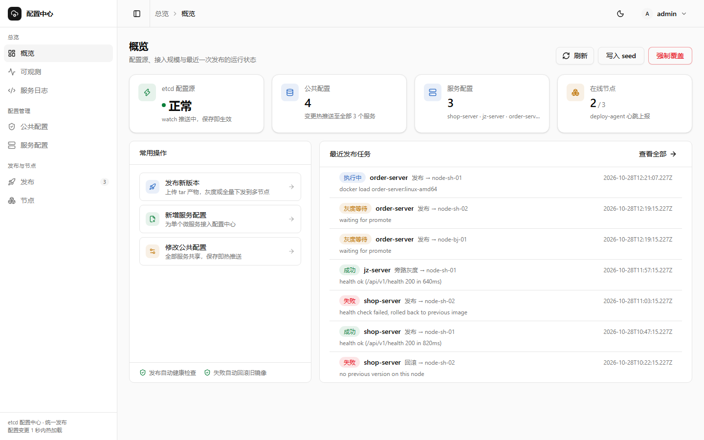
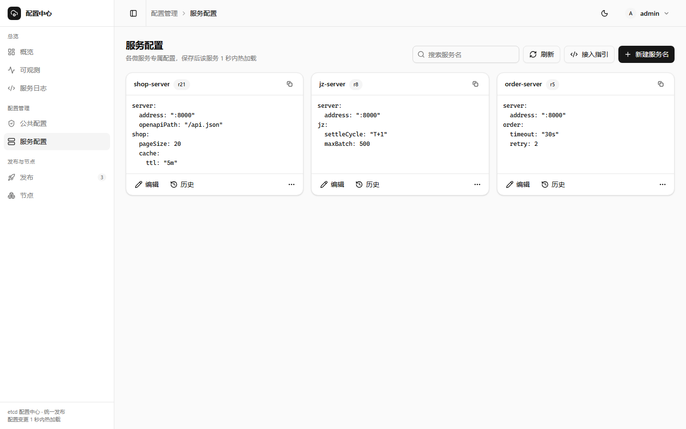
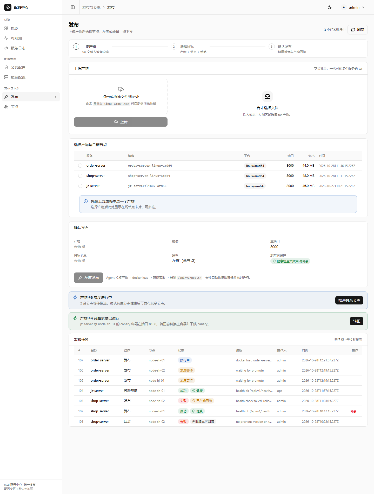
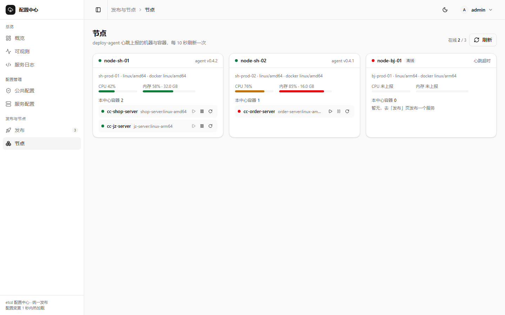

# configure-center

基于 **etcd + GoFrame** 的配置中心与镜像发布控制台。各微服务本地只保留一行 etcd 入口，业务配置由 `configure-server` 统一写入 etcd 并热更新；镜像打包成 tar 后由节点探针 `docker load` / `run` 下发，**不需要 SSH**。

面向内网 / 私有部署，支持信创达梦 DM8 与 Linux ARM64 离线环境。

[](./LICENSE) · [Gitee 仓库](https://gitee.com/lin_30_0/configure-center)

## 界面一览

中台前端基于 **shadcn/ui（Radix + Tailwind CSS 4）**，支持亮 / 暗双主题；下面截图来自当前版本。

| | |
|:--:|:--:|
| **概览**<br> | **服务配置**<br> |
| **发布**<br> | **节点**<br> |

全部 13 张截图与逐页说明见 [中台前端 · 界面一览](./docs/02-reference/web-console.md#界面一览)。截图由本地 mock 后端渲染，**服务名、节点、镜像、时间均为虚构数据**；暗色示例见 [亮 / 暗主题](./docs/02-reference/web-console.md#亮暗主题)。

## 文档

|  |  |
|--|--|
| **[文档索引](./docs/README.md)** | 全部文档一览与阅读顺序建议 |
| [快速开始](./docs/01-getting-started/quickstart.md) | 10 分钟跑通配置中心 + 微服务 + 中台页面 |
| [接入新微服务](./docs/01-getting-started/integrate-a-service.md) | 依赖 SDK + 一行 host + `cmd` 里 Boot |
| [打包与发布](./docs/01-getting-started/release-and-rollout.md) | 出 tar、灰度/全量、转正、回滚、节点启停 |
| [内网 ARM64 离线部署](./docs/01-getting-started/deploy-offline-arm64.md) | 目标机不能访问镜像仓库 |
| [常见问题](./docs/01-getting-started/troubleshooting.md) | 按报错原文查 |
| [架构与实现链路](./docs/02-reference/architecture.md) | 拓扑、两条链路、分层、设计边界 |
| [HTTP API 参考](./docs/02-reference/api.md) · [etcdcfg SDK](./docs/02-reference/etcdcfg-sdk.md) · [配置项字典](./docs/02-reference/configuration.md) · [表结构](./docs/02-reference/database-schema.md) · [deploy-agent](./docs/02-reference/deploy-agent.md) · [中台前端](./docs/02-reference/web-console.md) | 技术参考 |
| [仓库结构与构建](./docs/03-development/repo-layout.md) · [测试](./docs/03-development/testing.md) · [设计决策](./docs/03-development/design-decisions.md) | 开发文档 |
| [CONTRIBUTING](./CONTRIBUTING.md) · [CHANGELOG](./CHANGELOG.md) · [SECURITY](./SECURITY.md) · [CODE_OF_CONDUCT](./CODE_OF_CONDUCT.md) | 仓库治理 |

## 一分钟理解

两条互相独立的链路，只在**服务名**上对齐：

| 链路 | 真相源 | 流程 |
|------|--------|------|
| **配置热更新** | etcd | 中台改 YAML → etcd Put → 微服务 Watch → 内存 `g.Cfg()` 更新 |
| **镜像发布** | Postgres 任务表 + 磁盘 tar | 中台下发 job → Agent `docker load` / `run`（不经过 etcd） |

```
configure-server :9000  ──PUT/GET──►  etcd :2379  ──Watch/Get──►  微服务 :8000
      │                                     ▲                          │
      └── 审计/发布表 ◄── Postgres          └── seed / CRUD        g.DB / g.Redis
```

配置合并规则：`shared/*` 深层合并后，再由 `services/<服务名>` 覆盖同名项。

etcd 是运行时配置的**唯一真相源**，Postgres 只存审计与回滚，不做双写。配置中心不在热更新的数据面上——它挂了，已下发的配置照常读取。

## 目录

```
pkg/etcdcfg/          GoFrame 微服务共用 SDK（Boot + BindHealth）
examples/gf-service/  新服务复制模板
configure-server/     配置中心 HTTP API + etcd seed（:9000）
shop-server/          示例微服务（:8000）
web/                  中台前端（Vite + React + shadcn/ui，:5173）
deploy-agent/         节点 Agent（docker load / run）
deploy/               打包契约（catalog.json、runtime.Dockerfile）
docs/                 技术 + 使用 + 开发文档
go.work               本地多模块开发
```

## 快速开始

```bash
# 1. 基础设施（etcd + Postgres + Redis）
cd configure-server && make docker-up

# 2. 配置中心（启动时把缺失配置 seed 进 etcd）
make run                          # Swagger: http://127.0.0.1:9000/swagger/

# 3. 示例微服务
cd ../shop-server && make run

# 4. 中台前端
cd ../web && npm install && npm run dev   # http://127.0.0.1:5173
```

本地默认账户 `admin` / `admin123`、`operator` / `operator123`。**上线前务必换掉 `jwtSecret`、口令和 `agentToken`**，见 [SECURITY.md](./SECURITY.md)。

验证热更新：

```bash
curl http://127.0.0.1:8000/api/v1/config/runtime
```

在中台改 `test.shopName`，不重启 shop-server 再请求一次即可看到新值。

微服务本地配置只需 etcd 入口：

```yaml
svc:
  etcd:
    host: "127.0.0.1:2379@shop-server"   # ip:port@服务名
    watch: true
    snapshotDir: "data/config-cache"     # 合并 YAML 快照，etcd 不可用时回退
```

## 能力

**配置中心**

- etcd 直读 + Watch 热更新，150ms 防抖合并；`stickyKeys` 可指定不参与热重载的根 key
- 磁盘快照容灾：etcd 挂了就用上次的合并 YAML 启动（状态 `degraded`），后台自动重连
- 审计历史 + 一键回滚；首次修改前自动补录变更前快照（`BASELINE`）
- 合并预览接口与微服务启动用的是同一套代码，所见即所得
- JWT 登录、bcrypt 账户、失败锁定；审计操作人取自 token，不可伪造
- etcd RBAC：SDK 的 Watch 按「shared 前缀 + 本服务精确 key」拆分，可给每个服务只授最小读权限

**发布**

- `package.ps1` / `package.sh` 交叉编译 → `FROM scratch` → `docker save` 出 tar
- 策略：全量 / 多节点灰度 / 单节点旁路灰度（`cc-<服务>-canary`，不替换主容器）
- 发布后 TCP + HTTP 健康探测，失败自动回滚旧镜像
- 节点资源指标与部署推荐（按剩余内存和 CPU 打分，推荐不自动下发）
- 容器启停重启、镜像回滚、配置回滚各自独立

**可观测**

- 请求量 / RPS / 错误率 / P95、30 分钟流量图、状态码分布与 Top 路由
- Go 运行时指标（goroutine、堆内存、GC、uptime）
- SSE 实时日志控制台：级别 / 来源 / 服务过滤、关键字高亮、暂停、清空、回到最新
- 服务日志页：按服务聚合、全屏、下载、自动跟随

**明确不提供**

- **流量灰度**：发布页只决定新镜像在哪台机器、哪个端口跑起来。用户无感的白名单/比例切流需要独立的 API Gateway 读配置中心的路由规则，本仓库没有网关进程。
- **gRPC 配置通道**：配置走 etcd 直读，不需要。
- **配置加密**：etcd 里的 YAML 是明文，靠 RBAC 限制可读范围。

## 参与

读 [CONTRIBUTING.md](./CONTRIBUTING.md)。单元测试全部离线、约 1 秒：

```bash
go test ./pkg/etcdcfg/... ./configure-server/... ./shop-server/... ./deploy-agent/...
```

[docs/03-development/repo-layout.md](./docs/03-development/repo-layout.md) 末尾有一份「已知待办」，适合当作第一个 PR。

发现安全问题请按 [SECURITY.md](./SECURITY.md) **私密报告**。

## 许可

[MIT](./LICENSE)
