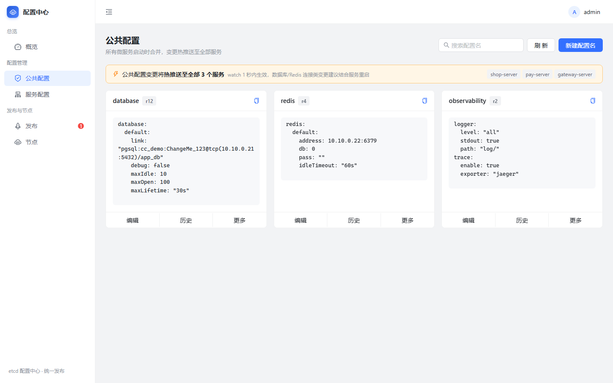
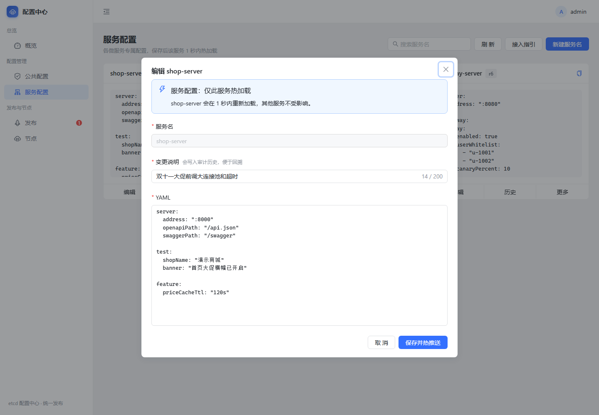
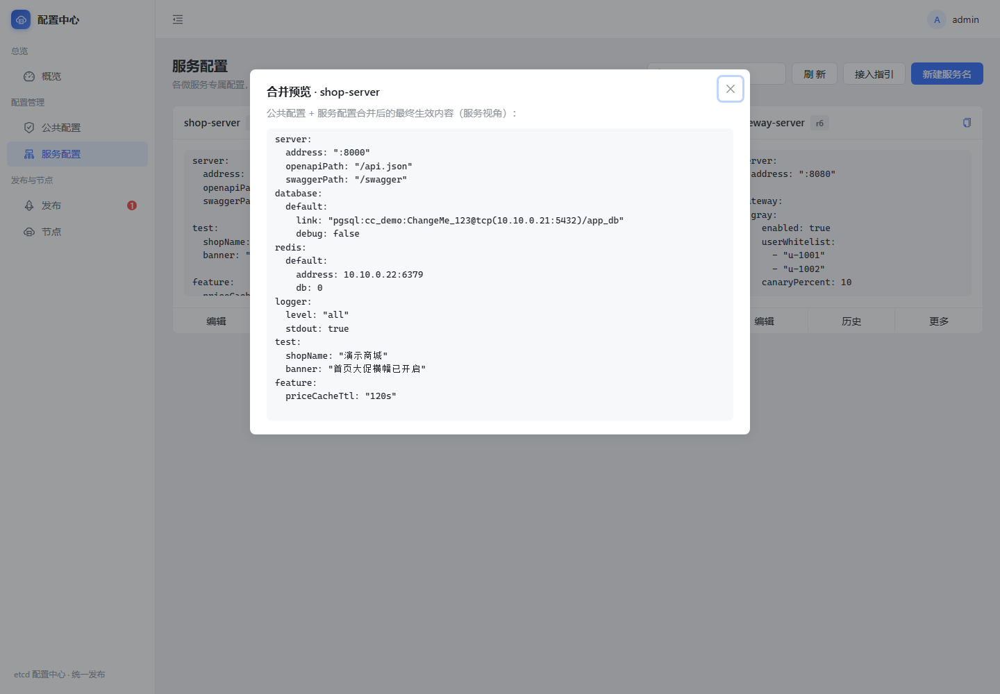
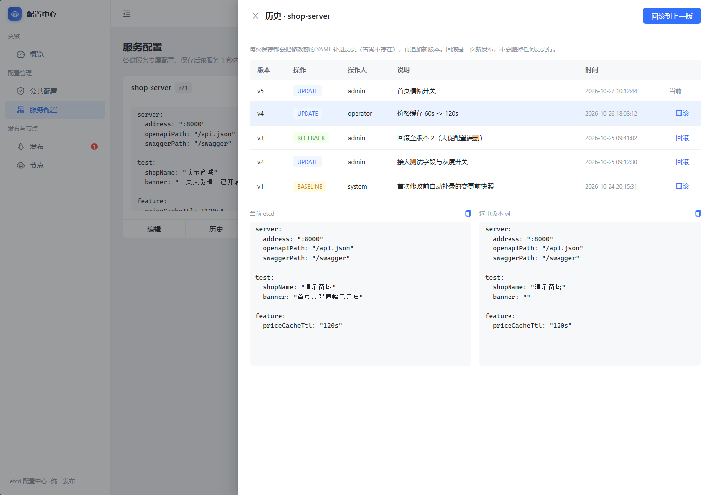
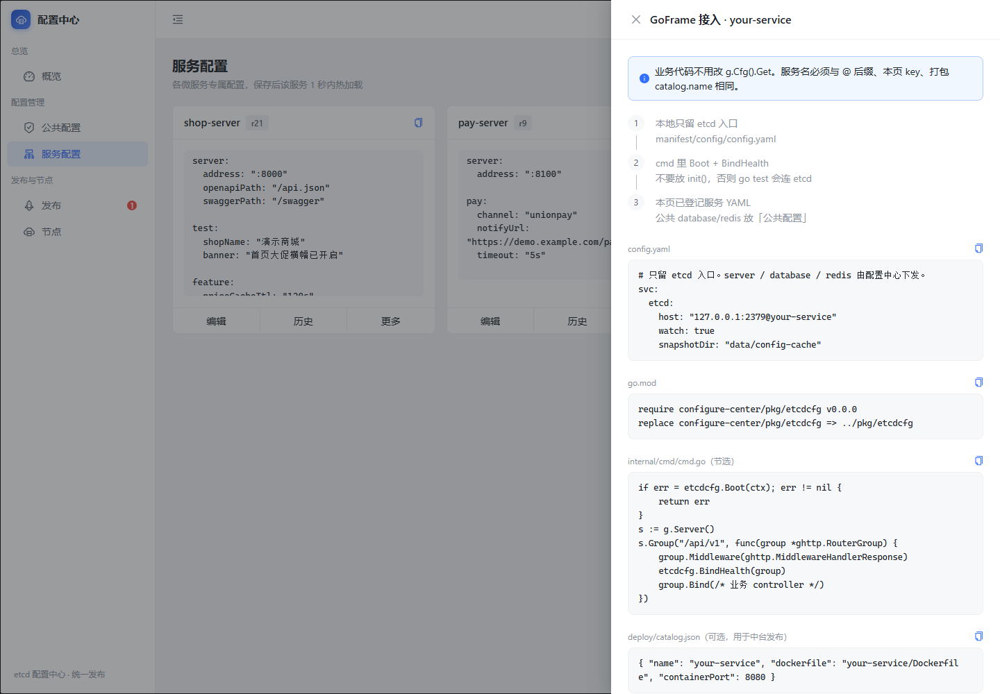
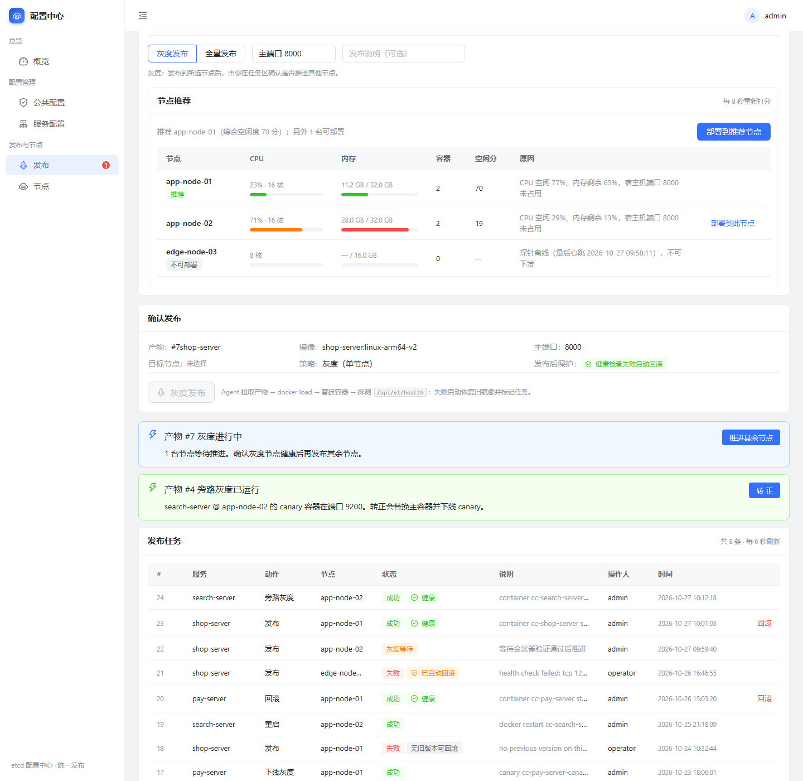

# 中台前端

`web/` 是配置中心的控制台：Vite 7 + React 19 + TypeScript 5.9 + shadcn/ui（Radix 原语）+ Tailwind CSS 4。

浏览器**只调 configure-server 的 HTTP API**，从不直连 etcd，也不碰 deploy-agent。

## 界面一览

> 以下截图由本地 mock 后端渲染，**服务名、节点、镜像、时间、账号都是虚构数据**，只用于展示界面与交互，不来自任何真实环境。
>
> **截图对应迁移前的 antd 版本**：界面结构、文案与交互一致，配色已换为中性灰阶 + 近黑主色，并支持亮/暗双主题。新 UI 的截图待有后端环境时重拍。

### 登录


未登录访问任意路由都会被 `RequireAuth` 弹到这里。左侧三张卖点卡对应配置热重载、统一发布、失败自动回滚三条链路；账户由 `configure-server` 的 `auth_users` 表（或 `auth.users` 配置）提供，本地默认见 [快速开始](../01-getting-started/quickstart.md)。

### 概览


四个指标卡分别是 etcd 连通状态、公共配置数量、服务配置数量、在线节点数（`last_seen < 45s` 记为在线）。右侧「最近发布任务」直接读发布任务表，把探针回写的英文 message 翻成中文说明；左下「常用操作」是三个高频入口的快捷跳转。「写入 seed」只补 etcd 里缺失的 key，「强制覆盖」会用 `manifest/etcd-seed` 整体重写，后者仅 `admin` 可执行。页面每 15 秒自动刷新一次。

### 公共配置



每张卡一个 `shared/*` key，卡片标题右侧的 `r12` 是 etcd 的 revision。顶部的黄色提示会实时列出当前受影响的服务名——公共配置保存后热推送至全部服务，所以这里比服务配置页多一道影响面提醒。数据库、Redis 这类连接串建议放这里，但变更通常要配合服务重启才生效。

### 服务配置


`services/<服务名>` 一张卡，卡片里直接渲染当前 YAML，不用点开就能读。「更多」菜单里有预览合并配置、接入代码、删除。搜索框按服务名过滤，接入代码见下文「接入指引」。

### 编辑配置



保存即 `PUT` + 热推送，没有草稿态。「变更说明」会写进审计历史，是必填项——回滚时全靠它判断该回到哪一版。服务配置的影响面提示只列当前服务，公共配置则提示会推送至全部服务。

### 合并预览



调 `GET /configs/preview/{name}`，返回 `shared/*` 深层合并后再被本服务覆盖的最终 YAML，与微服务启动时用的是同一套代码，所以预览结果就是生效结果。改关键项之前先看这里，能避免「服务配置只写了一半、把公共配置里同级的其它字段覆盖掉」。

### 历史与回滚



上半部分是版本列表（`UPDATE` / `ROLLBACK` / `BASELINE` 三种动作），下半部分把「当前 etcd」与选中版本并排对比。点非当前版本的「回滚」会追加一个新版本而不是删除历史——回滚本身也是一次发布，`BASELINE` 则是首次修改前自动补录的变更前快照。

### 接入指引



三段可复制代码：本地只留 etcd 入口的 `config.yaml`、`go.mod` 的 `replace`、`cmd` 里的 `Boot` + `BindHealth` 片段。内容与 [接入新微服务](../01-getting-started/integrate-a-service.md) 一致，改了 SDK 用法要同步 `web/src/onboard/snippets.ts`。

### 节点


`deploy-agent` 心跳上报的机器与容器。CPU / 内存进度条按 70% 变橙、85% 变红；探针没上报资源指标时显示「未上报」而不是 0，避免把「没数据」误读成「很空闲」。每台机器的容器列表可以直接启停、重启，离线卡片保留最后一次心跳时间。

### 发布


整页从上到下就是完整流程：上传 tar（按 `服务名-linux-arch.tar` 自动解析镜像名与平台）→ 选产物 → 选节点 → 确认发布。下方两条彩色横幅是仍在等待人工推进的任务：「灰度进行中」等确认后再发其余节点，「旁路灰度已运行」是把 canary 容器转正。最底部的任务表每 6 秒刷新一次状态。

### 节点推荐



选定产物后按各节点剩余资源打分（`0.4 × CPU 空闲 + 0.6 × 内存空闲`），并逐台给出不适合的原因——例如端口已被占用、探针离线。「部署到推荐节点」只是把选择结果填进表单，**不会自动下发**，仍需回到「确认发布」人工点一次。

### 这些截图是怎么来的

用一个只监听 `127.0.0.1` 的临时 mock API 顶替 `configure-server`，前端代码与真实运行时完全一致；截图工具链本身不入库，重新生成时需要三样东西：

1. **mock 后端**：按 [HTTP API 参考](api.md) 的响应包 `{ code, message, data }` 返回虚构数据即可，端口随意，只要代理指过去。
2. **注入脚本**：往 `index.html` 的 `<head>` 前面塞一段脚本，写 `localStorage['configure-center.token']` 伪造登录态，再按 URL 参数 `?shot=` 点开对应的弹窗 / 抽屉。
3. **headless Chrome**：`--headless=new --window-size=1440,1000 --virtual-time-budget=45000 --screenshot=out.png <url>`。

两个坑值得记一下：

- `--virtual-time-budget` 会把 Radix + `tw-animate-css` 的入场动画冻在 `data-state="open"` 的首帧（`opacity: 0`），弹窗、抽屉、下拉全是透明遮罩。截图前需要强制 `[data-slot="dialog-content"], [data-slot="sheet-content"], [data-slot="dropdown-menu-content"] { animation: none !important; opacity: 1 !important }`；退场同理要强制 `opacity: 0`，否则关掉的菜单会留在画面上。
- 断点与暗色由 `class="dark"` 和媒体查询驱动：`index.html` 的内联脚本会读 `localStorage['cc-theme']`，没写过时跟随 `prefers-color-scheme`。截图机器如果是暗色系统，先写入 `cc-theme=light` 再刷新，否则拿到的是暗色图。

## 依赖

| 包 | 版本 | 用途 |
|----|------|------|
| react / react-dom | 19.1 | UI |
| react-router-dom | 7 | 路由 |
| radix-ui | 1.x | shadcn 原语（Dialog / Sheet / Select / DropdownMenu 等） |
| lucide-react | 1.x | 图标 |
| class-variance-authority + tailwind-merge + clsx | - | 变体与 `cn()` 类名合并 |
| sonner | 2.x | 轻提示 toast |
| vite | 7.3 | 开发与构建（`react-vendor` / `radix-vendor` 手动分包） |
| @vitejs/plugin-react | 5 | React 快刷新 |
| tailwindcss | 4.1 | 设计 token、布局与排版 |
| @tailwindcss/vite | 4.1 | Tailwind 接入 |
| tw-animate-css | 1.x | Radix 组件入场/退场动画 |
| typescript | ~5.9 | `npm run build` 前先 `tsc` |

路径别名 `@` → `web/src`（`vite.config.ts`）。

## 目录

```
web/src/
  main.tsx                    入口
  App.tsx                     路由树 + ThemeProvider / TooltipProvider / ConfirmProvider / Toaster
  index.css                   设计 token（OKLCH）+ Tailwind 入口 + 基础样式
  api/
    client.ts                 fetch 封装：响应包解析 + Bearer 注入 + 401 跳登录
    auth.ts  config.ts  deploy.ts  observability.ts
  auth/
    session.ts                localStorage 读写 token
    AuthContext.tsx           登录态 Provider（启动校验 + 后端不可用重试）
    RequireAuth.tsx           路由守卫
  layouts/AdminLayout.tsx     侧边导航（可折叠/移动端抽屉）+ 顶栏 + 任务数徽标
  pages/
    LoginPage.tsx  OverviewPage.tsx  SharedPage.tsx  ServicesPage.tsx
    NodesPage.tsx  DeploysPage.tsx  ObservabilityPage.tsx  ServiceLogsPage.tsx
    ConfigListPage.tsx（被公共配置/服务配置两页复用）
  components/
    ui/                       shadcn 原语（由 CLI 生成，不要手改结构）
    PageHeader / StatCard / Panel / EmptyState / Meter / ToneBadge / InlineAlert
    YamlEditor                YAML 编辑与只读视图
    ConfigEditorDialog        新建/编辑配置
    HistorySheet              历史列表 + 版本对比 + 回滚
    RecommendPanel            节点推荐（调 /nodes/recommend）
    OnboardSheet              GoFrame 接入指引抽屉
    LogRow                    日志行渲染（两页复用）
    ConsoleIconButton         深色控制台图标按钮
    ConfirmProvider / ThemeProvider / ThemeToggle
  hooks/useLogStream.ts       SSE 日志流 + 暂停/继续 + 自动跟随
  lib/                        cn()、toast 封装、状态色、关键字高亮、控制台配色
  shared/console.css          日志控制台外壳样式（两页共用）
  onboard/snippets.ts         接入代码片段（config.yaml / go.mod / cmd.go）
```

## 路由与鉴权

`App.tsx`：

```
/login                      公开
RequireAuth                 守卫：无 token → /login；后端不可用时展示重试页
  AdminLayout
    index (/)               OverviewPage       概览
    /shared                 SharedPage         公共配置
    /services               ServicesPage       服务配置
    /nodes                  NodesPage          节点
    /deploys                DeploysPage        发布
    /observability          ObservabilityPage  可观测
    /service-logs           ServiceLogsPage    服务日志
*                           Navigate → /
```

菜单分三组（`layouts/AdminLayout.tsx`）：总览 / 配置管理 / 发布与节点。「发布」菜单项带任务数徽标，显示当前 `activeJobs` 数量；折叠时只保留图标 + 小红点。

### 登录流

```
LoginPage → POST /api/v1/auth/login
  → setToken(res.token)           localStorage 键 configure-center.token
  → AuthProvider 写入用户与角色
之后每次请求 api/client.ts 自动带 Authorization: Bearer <token>
```

`AuthProvider` 挂载时若本地已有 token，调 `GET /api/v1/auth/me` 验证有效性并恢复登录态。只有明确 401 才清 token；后端未启动或网络错误时**保留凭据**，由 `RequireAuth` 展示「无法连接配置中心服务」并提供重试 / 重新登录。

### `api/client.ts` 的约定

- 解析 GoFrame 响应包 `{ code, message, data }`，**只返回 `data`**。
- `HTTP 401` 或 `code === 401` → `redirectLogin()`（清 token + 跳 `/login`），随后抛 `ApiError`。`/auth/login` 自身除外，避免登录失败也把表单清空。
- `!res.ok` 或 `code !== 0` → 抛 `ApiError(code, message)`，`message` 直接是后端中文错误原文，页面直接展示。
- 网关/代理不可用时返回的是空体或 HTML：5xx 统一提示「服务暂不可用（HTTP 5xx），请确认 configure-server 已启动」，不把 JSON 解析异常抛给用户。
- 有 body 且未显式设 `Content-Type` 且**不是 FormData** 时才补 `application/json`——FormData 必须让浏览器自己带 boundary，这是上传 tar 能工作的原因。

## 页面 ↔ 接口

| 页面 | 前端模块 | 后端接口 |
|------|----------|----------|
| 登录 | `api/auth.ts` | `POST /auth/login`、`GET /auth/me` |
| 概览 | `api/config.ts` + `api/deploy.ts` | `GET /health`、`GET /configs/shared`、`GET /configs/services`、`GET /nodes`、`POST /configs/seed` |
| 公共配置 | `api/config.ts` | `GET/PUT/DELETE /configs/shared{,/{key}}`、`/history`、`/rollback` |
| 服务配置 | `api/config.ts` | `GET/PUT/DELETE /configs/services{,/{name}}`、`GET /configs/preview/{name}`、`/history`、`/rollback` |
| 节点 | `api/deploy.ts` | `GET /nodes`、`POST /deploys/lifecycle` |
| 发布 | `api/deploy.ts` | `GET/POST /artifacts`、`POST /deploys`、`GET /deploys`、`POST /deploys/rollback`、`POST /deploys/promote`、`GET /nodes/recommend` |
| 可观测 | `api/observability.ts` | `GET /observability/overview`、`GET /observability/logs`、`GET /observability/logs/stream` |
| 服务日志 | `api/observability.ts` | `GET /observability/logs`、`GET /observability/services`、`GET /observability/logs/stream` |

`ConfigListPage.tsx` 是公共配置和服务配置共用的列表基组件，通过 props 决定走 `shared` 还是 `services` 分支——改一处两页同时生效。

## 设计与主题

视觉语言是 shadcn/ui 的 `new-york` 风格：中性灰阶 + 近黑主色、1px 细边框、极轻阴影、紧凑密度。

- **token 唯一来源**：`web/src/index.css` 的 `:root` / `.dark` 定义 `--background`、`--foreground`、`--border`、`--success`、`--chart-*` 等语义变量，`@theme inline` 再映射成 Tailwind 类；页面里不写十六进制色值。改主题只改这一个文件。
- **亮/暗双主题**：`components/ThemeProvider.tsx` 在 `<html>` 上切换 `dark` class，选择写入 `localStorage['cc-theme']`；`index.html` 的内联脚本在首帧前恢复，避免闪白。未手动选择时跟随系统。
- **组件分层**：
  - `components/ui/*` 是 shadcn 原语（Button / Dialog / Sheet / Select / Table …），由 CLI 生成，只在使用处用 `className` 微调；
  - `components/*` 是业务通用件（`Panel`、`StatCard`、`EmptyState`、`Meter`、`ToneBadge`、`InlineAlert` …），承载间距、密度与语义色；
  - 页面只做组合，不直接写色值。
- **颜色语义**：`success` / `warning` / `info` / `destructive` 只用于状态；`chart-1..5` 只用于图表；日志控制台在两种主题下固定 `zinc-950` 深色，外壳与滚动条样式在 `shared/console.css`，两页共用。
- **反馈约定**：异步结果用 `sonner` toast（`lib/notify.ts`）；二次确认统一走 `ConfirmProvider` 的 `confirm()`，支持必填原因与异步 `onConfirm`（对话框内 loading，失败自动 toast 并留在原地）；首屏用 `Skeleton`，空数据用 `EmptyState`。自动轮询（发布 6s / 节点 10s / 概览 15s / 指标 10s）失败时只在**首屏或手动刷新**提示，避免周期性弹 toast。
- **新增原语**：`npx shadcn@latest add <component>` 生成到 `components/ui/`，不要手写同结构组件，也不要改生成文件的结构与变体命名。

## 关键交互

### YAML 编辑与预览

编辑器 `components/YamlEditor.tsx` 只做文本编辑，**语法校验在服务端**：`PUT` 时 `yamlToMap` 解析，根节点不是 map 直接报 `YAML 根节点必须是 map`。前端拿到这个 message 展示。

服务配置页保存前可以先点「预览」调 `GET /configs/preview/{name}`——它用的是与微服务启动时**同一套**合并代码（`Client.LoadMergedYAML`），所以预览结果就是线上生效结果。改关键项之前先看预览，能避免「服务配置只写了一半、覆盖掉公共配置同级的其它字段」这类问题。

### 历史与回滚

`components/HistorySheet.tsx`：列 `GET /configs/history/{kind}/{key}`，两版本内容对比，非当前版本可点回滚 → `POST /configs/rollback`。

回滚返回新版本号，抽屉刷新后顶部会多一条 `ROLLBACK`。当前版本在 UI 上不可点回滚（后端也会拒绝：`该版本已是当前配置，请选择更早的历史版本`）。

### 发布与推荐

`pages/DeploysPage.tsx`：选产物 → `RecommendPanel` 调 `GET /nodes/recommend?artifactId&hostPort` → 展示每台节点的 `eligible` / `score` / `reason` 和推荐结论 → 人工选节点与端口、选策略（`canary` / `all`、`canaryCount`、`canaryHostPort`）→ `POST /deploys`。

**推荐只是建议，不会自动下发。**

`api/deploy.ts` 里有两个专门处理 Agent message 的辅助函数：

- `parseJobSemantics(message)` —— 把探针回写的英文 message（`health ok`、`rolled back`、`no previous version` 等）翻成中文说明并附在任务行上
- `jobStatusLabel(status)` / `actionLabel(action)` —— 状态与动作的中文标签

这些字符串是**跨语言约定**：改探针的 message 文案要同步改 `parseJobSemantics`，否则中台会退回显示原始英文。

### 接入指引

`pages/ServicesPage.tsx` 的抽屉里展示 `onboard/snippets.ts` 的三段可复制代码（本地 `config.yaml`、`go.mod` replace、`cmd.go` 的 Boot 片段），内容与 [接入新微服务](../01-getting-started/integrate-a-service.md) 一致。改了 SDK 的用法要同步这里。

## 开发与构建

```bash
cd web
npm install            # 或 npm ci
npm run dev            # :5173
npm run build          # tsc && vite build → web/dist
npm run preview        # 本地预览构建产物
```

`vite.config.ts` 的代理：

```ts
server: {
  port: 5173,
  proxy: { '/api': { target: 'http://127.0.0.1:9000', changeOrigin: true } }
}
```

所以本地开发**必须先起 configure-server**，否则所有接口 502。代理只覆盖 `/api`，`/swagger` 和 `/api.json` 不经过它——需要时直接开 `http://127.0.0.1:9000/swagger/`。

### 生产部署

`npm run build` 产出纯静态文件，服务器**不需要 Node**。由 nginx 托管并把 `/api` 反代到 `127.0.0.1:9000`，完整配置见 [内网 ARM64 离线部署](../01-getting-started/deploy-offline-arm64.md#5-改配置再启动)。

要点：

- SPA 路由回退 `try_files $uri $uri/ /index.html`
- 上传 tar 需要 `client_max_body_size` 与后端 `server.clientMaxBodySize` 对齐（默认 512m）
- `web/.gitignore` 排除了 `dist`，构建产物不入库

## 新增页面的约定

1. 在 `src/pages/` 加组件；
2. 在 `App.tsx` 的 `<Route element={<AdminLayout />}>` 下加子路由（自动被 `RequireAuth` 保护）；
3. 在 `layouts/AdminLayout.tsx` 对应分组里注册菜单项（`key` 用路由路径）；
4. 接口封装放 `src/api/`，走 `client.ts` 的 `request`，不要自己 `fetch`——否则丢掉 401 跳登录和响应包解析。

## 相关文档

- [HTTP API 参考](api.md) —— 每个字段的定义
- [架构与实现链路](architecture.md) §6 —— 登录与页面链路
- [打包与发布](../01-getting-started/release-and-rollout.md) —— 发布页的完整工作流
